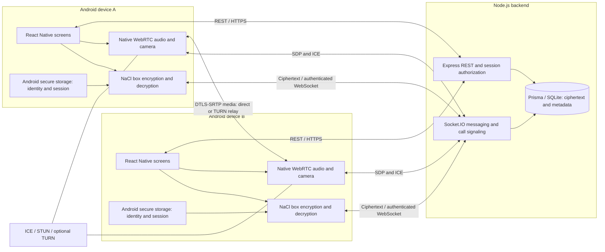

# CipherLink implementation architecture

REST handles registration, login, user discovery, conversation creation, paginated history, read state, ICE configuration and logout. WebSocket connections authenticate with the same expiring, revocable session. Every application event revalidates that session; a server timer disconnects sockets on expiration. Socket.IO never carries raw microphone or camera data.

The server fixes sender identity from the session, checks conversation membership and registered public keys, accepts strict encrypted envelopes, and stores stable message IDs. Retries reuse the envelope and ID, including after an acknowledgment is lost. REST history reconciles the latest messages after reconnect; earlier messages load with an explicit cursor. Unsent envelopes stay only in the screen's memory; there is no persistent offline outbox.

Calls have an authenticated initiator, designated recipient, owning socket IDs, ringing/accepted state, timeout and busy guard. Only those sockets can relay SDP/ICE. The callee acquires media before accepting; ICE is queued until a remote description exists. Microphone mute and camera controls operate on native media tracks. Closing a call, disconnecting or entering the background stops tracks and closes the peer connection. Calls are foreground-only.

SQLite access is confined to server modules through Prisma. A PostgreSQL migration requires changing the Prisma datasource, providing a PostgreSQL URL and generating provider-specific migrations; it is not a database URL-only change. Call state and presence live in one server process. Scaling to multiple processes requires shared call state, a Socket.IO adapter and coordinated busy/timeout ownership.

## Cryptography and trust

TweetNaCl's established `nacl.box` construction uses Curve25519 key agreement with XSalsa20-Poly1305 authenticated encryption and random 24-byte nonces. Expo Crypto supplies native cryptographic randomness. The client encrypts JSON containing text plus message ID, conversation ID and both public keys. Decryption validates the embedded metadata, so rerouting an authentic ciphertext under altered metadata fails locally.

Private keys are generated and persisted before account registration. They are scoped by server origin and username, retained through logout, and never uploaded. A signed-in server-address change verifies the account ID, username and public key using the current session before linking the new origin to the original local identity realm. This preserves both the private identity and existing contact pins; unrelated, unlinked origins remain separate. Login checks that the existing device public key matches the registered public key. Missing keys block login rather than silently generating a replacement. SecureStore is configured to exclude device-bound material from Android backup restoration. Uninstall or app data clearance loses the identity. There is no recovery or multi-device transfer.

Contact keys use trust on first use, with secure local pinning and a visible SHA-512-derived 256-bit fingerprint. A changed key blocks communication; there is no automatic trust reset. Compare fingerprints outside CipherLink over a trusted channel. A malicious server or a network attacker during the first HTTP key exchange can substitute keys before they are pinned. TLS and independent verification are necessary defenses.

Static long-term keys do **not** provide forward secrecy or a Signal Double Ratchet. A compromised key can expose previously recorded ciphertext. Messages are decrypted only in client memory; there is no persistent plaintext message cache. Device compromise, screenshots and a compromised OS are outside the protection provided here. JavaScript garbage collection prevents reliable guarantees about zeroizing strings and copied keys.

WebRTC provides encrypted DTLS-SRTP media transport. Signaling is server mediated and is not independently bound to the messaging identity key. Fingerprint verification of chat keys does not independently verify call media identity against a malicious signaling server. This is not a claim of Signal-grade security.

The server observes accounts, public keys, contact relationships, timestamps, encrypted message lengths, IP addresses, sessions, presence and signaling including ICE addresses/SDP. TURN may relay encrypted media and observe transport metadata. Message text and private keys are not in the application database. Passwords use bcrypt cost 12; JWTs last seven days and reference revocable database sessions. No password reset, identity rotation, push notification or reliable background calling is implemented.

Implementation references: [TweetNaCl API](https://github.com/dchest/tweetnacl-js), [React Native WebRTC](https://github.com/react-native-webrtc/react-native-webrtc), [Expo WebRTC config plugin](https://github.com/expo/config-plugins/tree/main/packages/react-native-webrtc).
